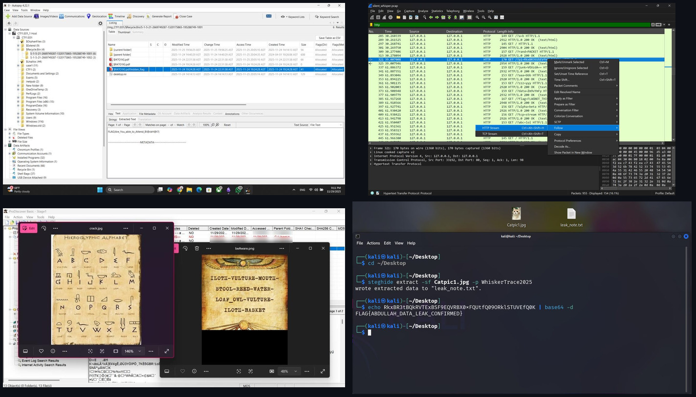

# Cyber Squad: Digital Forensics CTF

Eight original **digital forensics Capture the Flag challenges**, built from scratch as realistic incident investigations, and a web training platform to play them on.

Each challenge drops the player into a case: a student tampering with an exam server, a professor faking her attendance, an employee leaking company data. Players get real forensic evidence, such as a disk image, a packet capture, or a set of documents, and have to investigate it the way an analyst would to find the hidden flag.

**Live platform:** [cyber-squad-b981d9ad.base44.app](https://cyber-squad-b981d9ad.base44.app) (sign-in required)



## Challenges

| # | Challenge | The case | Difficulty | Main techniques |
|---|---|---|---|---|
| 1 | [The Stolen Exam Attempt](challenges/01-stolen-exam) | A student accessed the exam server before the quizzes | Easy | Disk image analysis, Recycle Bin recovery, recent-file artifacts |
| 2 | [The Phantom Checkout](challenges/02-phantom-checkout) | A professor clocks out at exactly 4:00 PM every day, even when she is not in the building | Medium to Hard | Linux disk forensics, SQLite database review, cron job and log analysis |
| 3 | [The Integrity Breach](challenges/03-integrity-breach) | Three near-identical reports, only one untouched original | Easy | SHA-256 hashing, file integrity verification |
| 4 | [The Egyptian Hidden Artifact](challenges/04-egyptian-artifact) | A museum idol vanishes from a shipment | Medium | Two-stage investigation across two PCs, hieroglyph cipher, email evidence |
| 5 | [Operation Silent Whisper](challenges/05-silent-whisper) | Data is exfiltrated through HTTP requests | Medium | PCAP analysis, HTTP stream reconstruction, decoy filtering, Base64 |
| 6 | [The Final Post](challenges/06-final-post) | An engineer disappears after leaking company data | Hard | Disk image triage, social media artifacts, steganography (Steghide) |
| 7 | [The Whispered Key](challenges/07-whispered-key) | Late-night traffic from a student lab computer | Easy to Medium | Packet comment analysis, Base64, AES-256 encrypted archive |
| 8 | [Hidden Strings](challenges/08-hidden-strings) | An image that looks normal but hides data | Easy to Medium | Binary string extraction, grep filtering, Base64 decoding |

Every challenge folder has the scenario, the skills it tests, how the evidence was built, and a full step-by-step solution. **Solutions are hidden behind spoiler sections**, so you can try each challenge first.

## Skills Covered

- **Disk and file system forensics:** working with forensic images, deleted files, the Recycle Bin, recent documents, and Linux system folders
- **Network forensics:** reading packet captures, following HTTP streams, and separating real exfiltration from decoy traffic
- **Integrity and hashing:** proving which file is original with SHA-256
- **Hidden data:** steganography, embedded strings, encoded payloads, and encrypted archives
- **Investigation thinking:** connecting clues across several sources (logs, databases, emails, social media) to explain what happened and who did it

## How the Challenges Were Built

Each case was designed backwards from the flag. We decided what the attacker did, planted the evidence they would realistically leave behind, and added decoys so players have to reason rather than guess.

| Tool | Used to build |
|---|---|
| FTK Imager, dcfldd | Forensic disk images from virtual machines |
| ProDiscover Basic | Evidence images for the multi-device cases |
| SQLite, cron | A working attendance database and the scheduled job that tampers with it |
| tcpdump, Python | Packet captures with real payloads mixed into generated noise traffic |
| Steghide | Data hidden inside images |
| 7-Zip (AES-256) | Password-protected evidence archives |
| Kali Linux terminal | Encoding payloads and testing every extraction step |

Every challenge was then solved end to end with standard analyst tools (**Autopsy, ProDiscover, Wireshark, CyberChef, Kali Linux**) to confirm that each flag is reachable and that the intended path is the one that works.

## The Platform

The challenges are published on **Cyber Squad**, a web training platform I built for the project. It includes:

- **Challenges:** the full challenge list with scenarios and difficulty levels
- **Challenge pages:** case details, evidence, and flag submission
- **Dashboard:** player progress
- **Learning path:** a suggested order from easy to hard
- **Tools:** a guide to the forensic tools used in the challenges

## Repository Structure

```
cyber-squad-forensics-ctf/
├── challenges/
│   ├── 01-stolen-exam/          # Each folder: README with scenario + solution
│   ├── 02-phantom-checkout/     # and images/ with investigation screenshots
│   ├── 03-integrity-breach/
│   ├── 04-egyptian-artifact/
│   ├── 05-silent-whisper/
│   ├── 06-final-post/
│   ├── 07-whispered-key/
│   └── 08-hidden-strings/
└── docs/
```

## What I Learned

- **Building a challenge teaches more than solving one.** To hide evidence convincingly, you have to understand exactly where forensic tools look and what traces each action leaves.
- **Realism comes from decoys.** Real investigations are full of noise. The challenges that taught the most were the ones with fake flags and junk traffic that players had to rule out.
- **Testing is part of the design.** Solving every challenge with a fresh tool chain caught broken paths and unintended shortcuts before players ever saw them.
- **Good cases connect evidence.** The strongest challenges make players combine clues from different sources, which is how real incidents are actually solved.

## Team

Built by **Cyber Squad**, a team of four Cybersecurity and Digital Forensics students at Imam Abdulrahman Bin Faisal University.

## Disclaimer

All scenarios, people, companies, and accounts in these challenges are fictional and were created for education.
