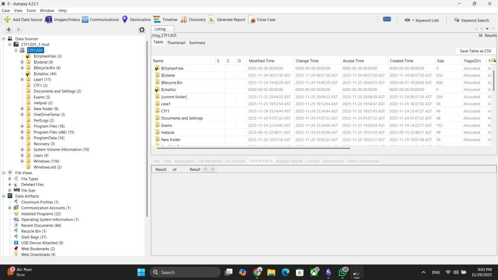
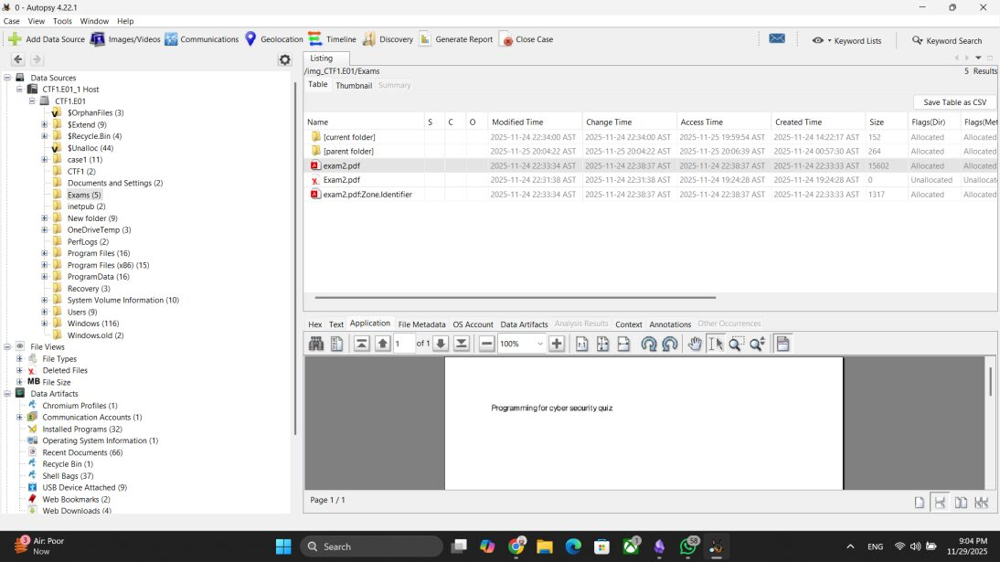
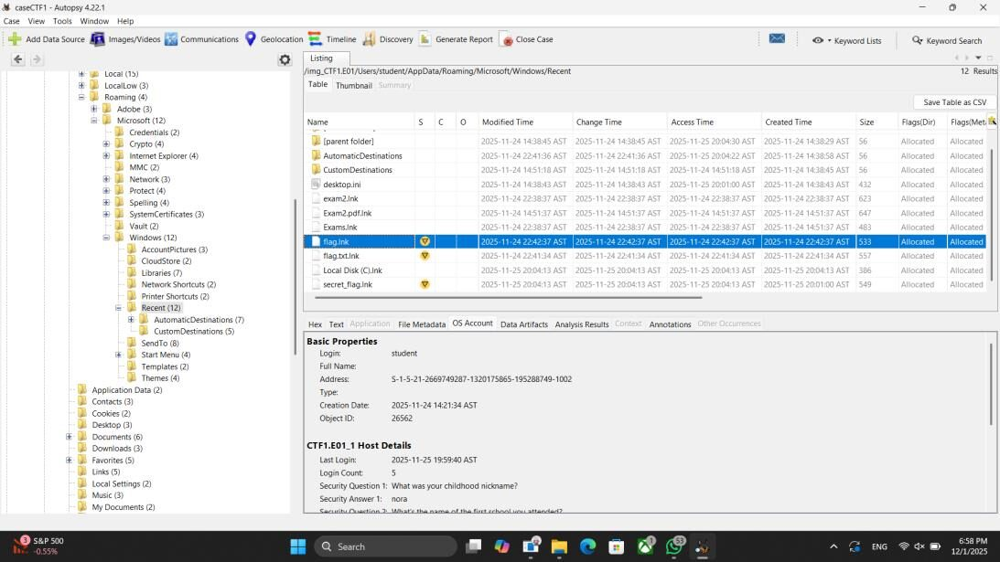
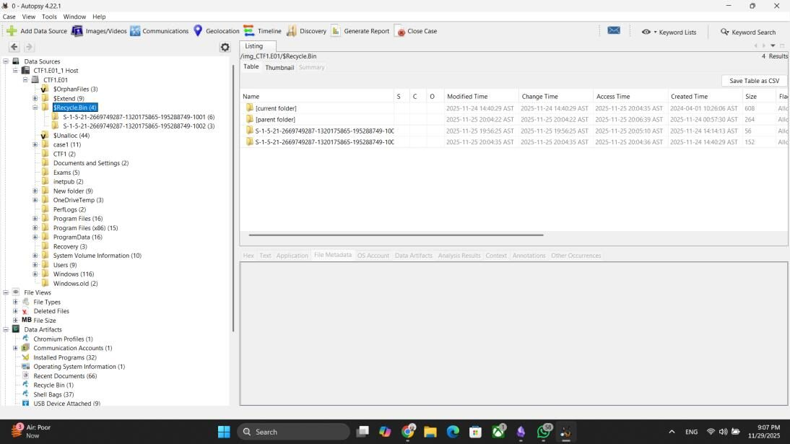
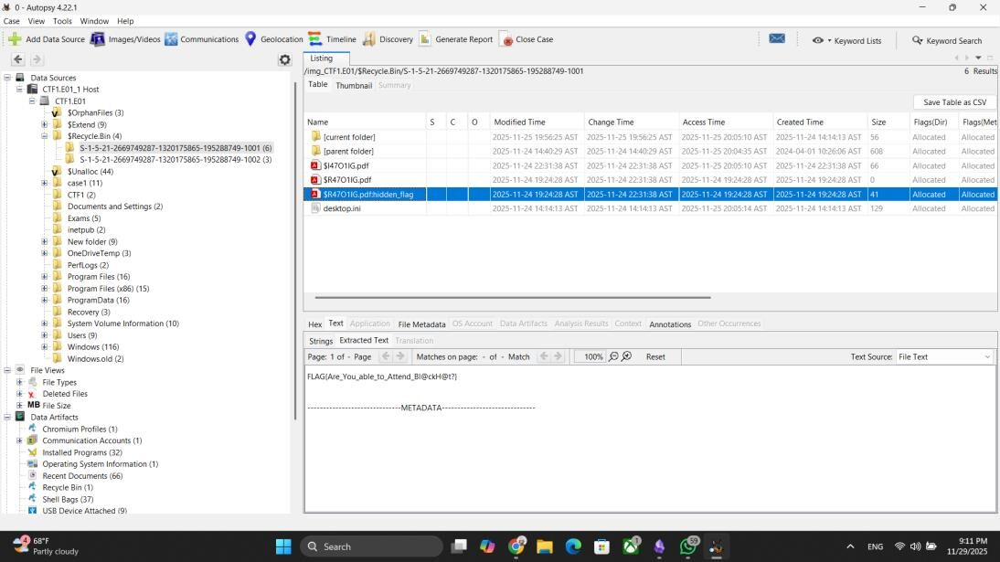

# Challenge 1: The Stolen Exam Attempt

**Difficulty:** Easy  
**Solved with:** Autopsy

## The Case

A cybersecurity student wanted to attend the Black Hat conference, but several quizzes were scheduled on the same days. While reviewing activity logs on the university's internal server, the professor noticed a suspicious remote access attempt on the exam file. A disk image of the machine was collected.

**Player task:** Find the hidden message the attacker left behind.

## Skills Tested

- Loading and navigating a forensic disk image
- Reviewing recent-document artifacts to see what a user opened
- Recovering deleted files from the Windows Recycle Bin

## How We Built It

- FTK Imager to capture the disk image from a Windows virtual machine
- Windows command line to hide the flag inside a PDF that is then deleted

## Solution

<b>Show the full walkthrough (spoilers)</b>

### Step 1: Load the image in Autopsy

Create a new case, add the disk image as a data source, and browse the file system.

### Step 2: Find the exam files

The exams folder contains the professor's exam PDFs, which confirms what the attacker was after.

### Step 3: Check recent documents

The user's Recent folder shows a student account opened the exam files and several flag-named files. Those files were permanently deleted, so they are a dead end.

### Step 4: Look in the Recycle Bin

The student may have missed something. The Recycle Bin holds per-user folders for each account.

### Step 5: Recover the deleted PDF

A deleted PDF in the Recycle Bin contains the hidden flag in its extracted text.

**Flag:** shown in the final screenshot.

---

[All challenges](../../README.md#challenges) | [Next challenge](../02-phantom-checkout)
