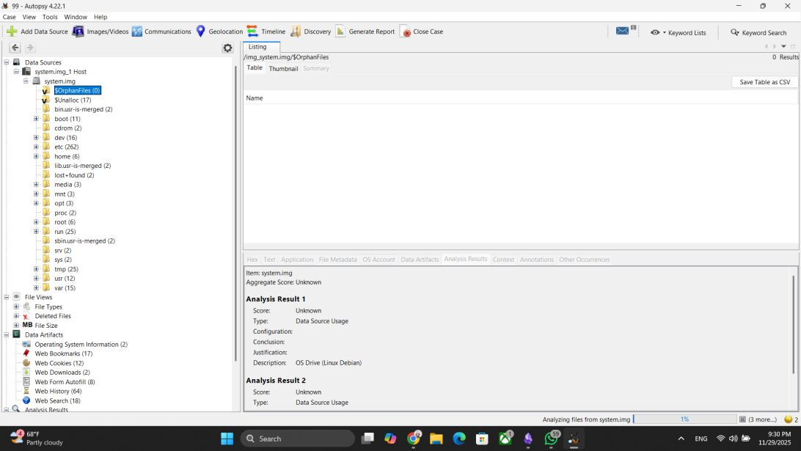
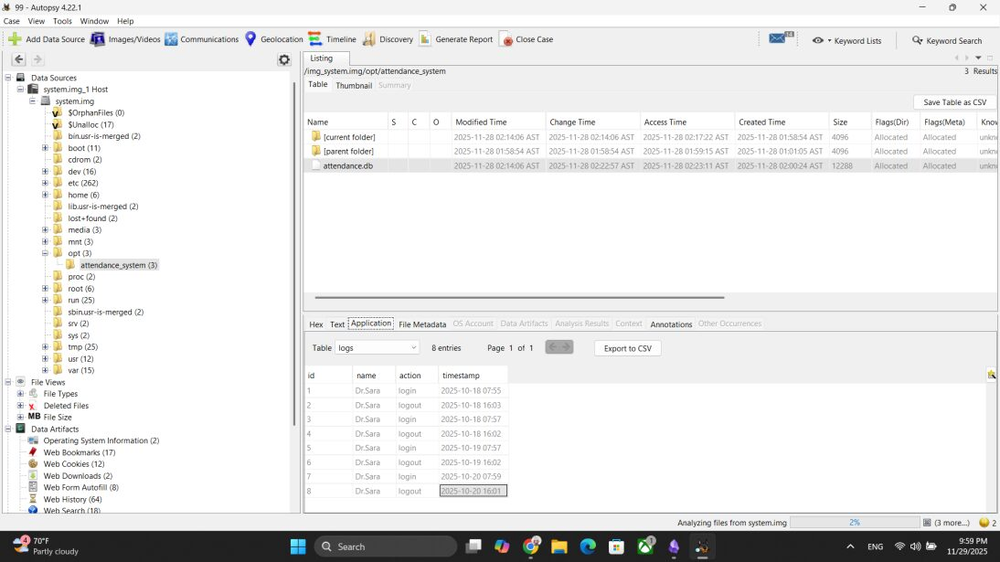
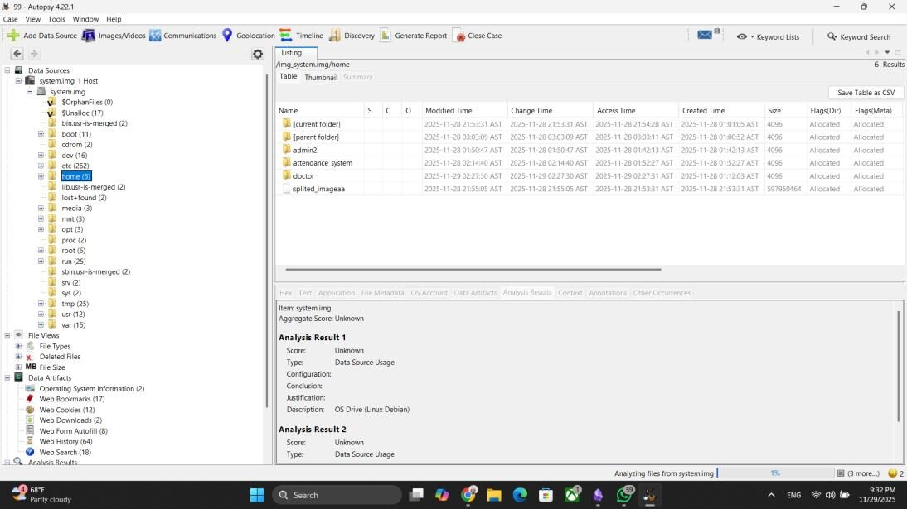
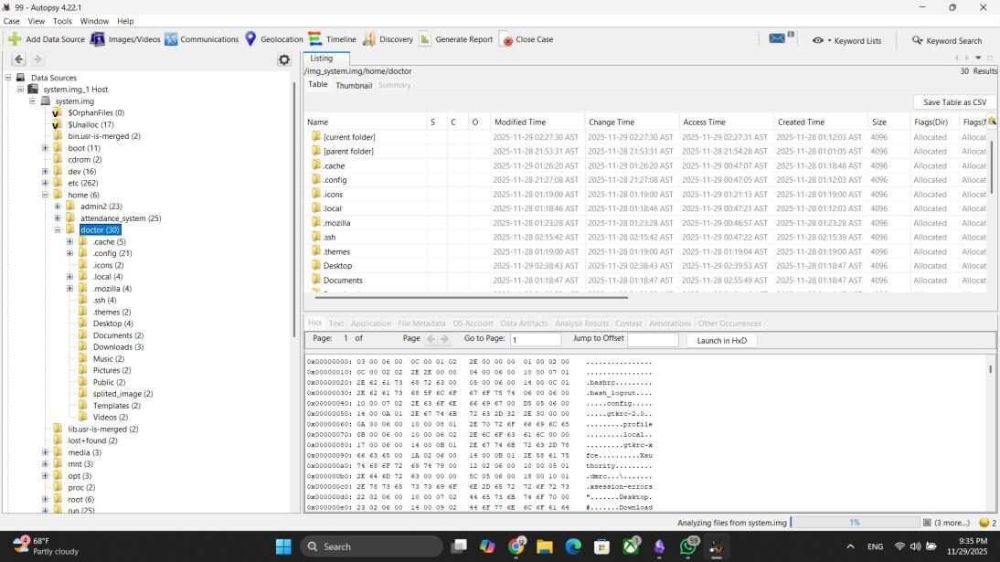
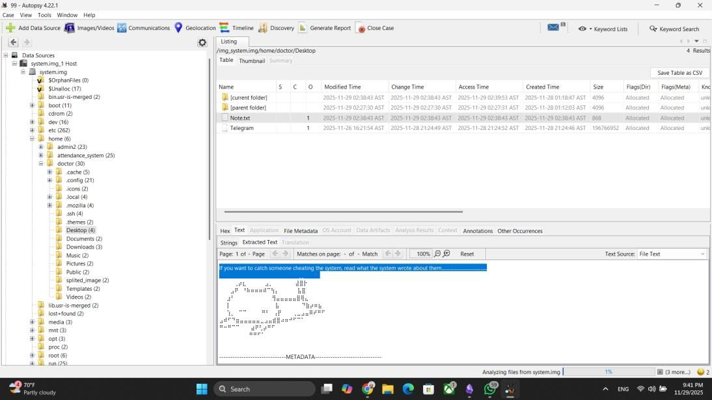
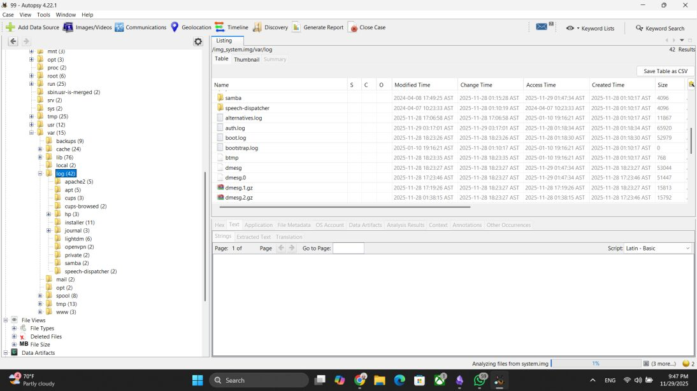
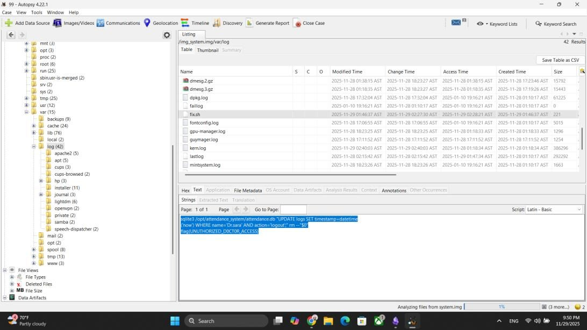

# Challenge 2: The Phantom Checkout

**Difficulty:** Medium to Hard  
**Solved with:** Autopsy

## The Case

The university introduced a fingerprint attendance system for faculty, connected to a central server. Professors must stay until 4:00 PM to clock out. Campus security noticed one professor was recorded clocking out at exactly 4:00 PM every day, even on days she was not in the building. A disk image was taken from her computer.

**Player task:** Prove how the attendance records were faked.

## Skills Tested

- Linux file system forensics (/opt, /home, /var/log)
- Reviewing a SQLite database inside a disk image
- Finding malicious automation in cron jobs and scripts

## How We Built It

- SQLite to build a working attendance database
- A cron job and shell script that update the database every day at 4:00 PM
- dcfldd to capture the disk image

## Solution

<b>Show the full walkthrough (spoilers)</b>

### Step 1: Load the image in Autopsy

Create a new case and add the Linux disk image.

### Step 2: Find the attendance database

Under /opt, the attendance system's database shows Dr. Sara logging out on time every day, which contradicts what security saw.

### Step 3: List the system users

The /home directory shows the accounts on the machine, including the doctor's account.

### Step 4: Explore the doctor's account

Her home folder holds the usual configuration and user folders.

### Step 5: Read the note on her desktop

A note on the desktop hints that the answer is in what the system itself wrote, pointing to the logs.

### Step 6: Search the logs

Browse /var/log for anything unusual.

### Step 7: Find the script

A shell script in the logs folder runs an UPDATE on the attendance database through a cron job, logging her out automatically every day. The flag is inside the script.

**Flag:** shown in the final screenshot.

---

[Previous challenge](../01-stolen-exam) | [All challenges](../../README.md#challenges) | [Next challenge](../03-integrity-breach)
