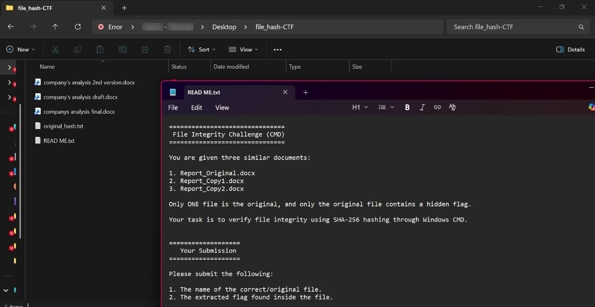
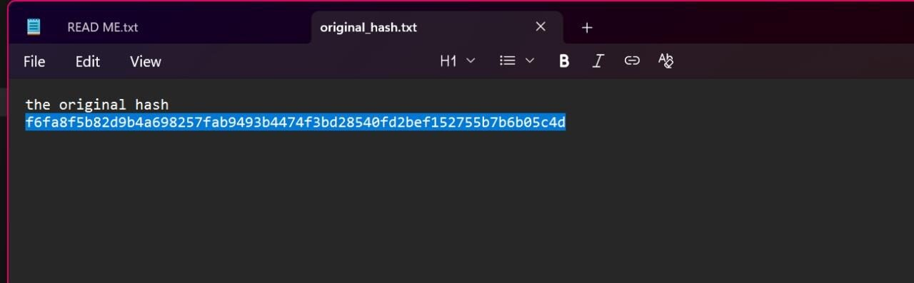
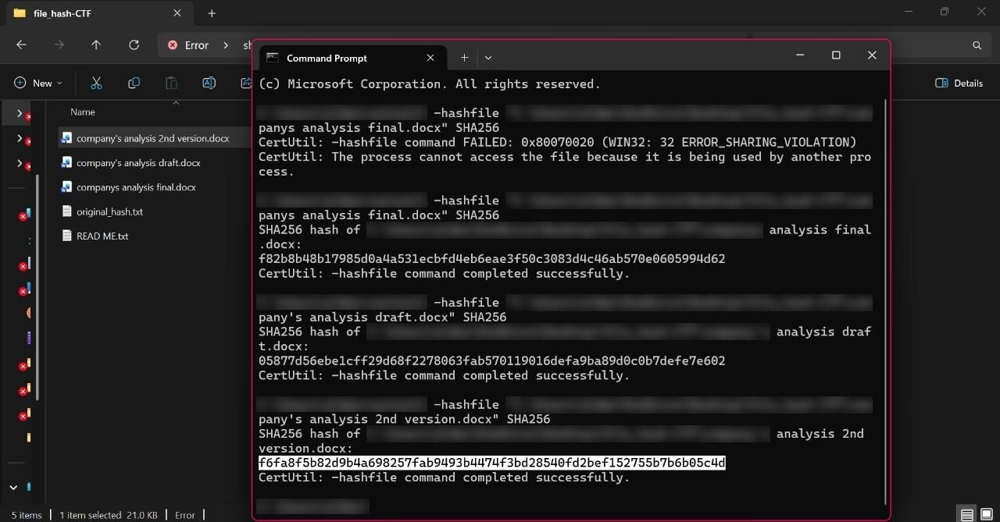
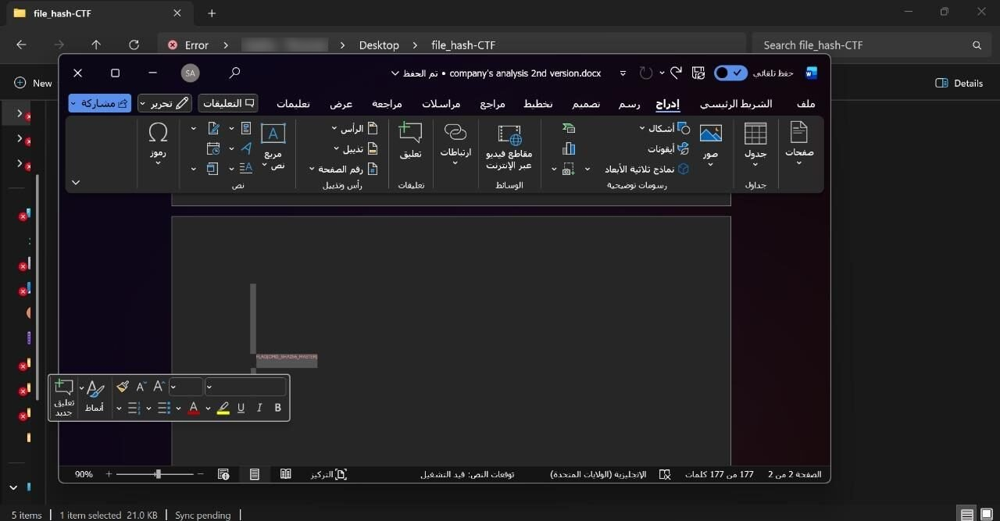

# Challenge 3: The Integrity Breach

**Difficulty:** Easy  
**Solved with:** Windows command line (certutil), Microsoft Word

## The Case

A confidential security report at a company was altered. Three nearly identical copies have surfaced, but only one is the untouched original. A hidden message inside the authentic file is the only proof its integrity was preserved.

**Player task:** Identify the original file using its hash and find the hidden message inside it.

## Skills Tested

- Calculating SHA-256 hashes from the command line
- Using hash comparison to verify file integrity
- Inspecting document content for hidden data

## How We Built It

- Three near-identical Word documents, one of them original
- A README with the original hash and submission instructions

## Solution

<b>Show the full walkthrough (spoilers)</b>

### Step 1: Read the brief

The included README explains the case and gives the hash of the original report.

### Step 2: Note the original hash

The reference SHA-256 value is the baseline to compare against.

### Step 3: Hash every candidate

Calculate the SHA-256 hash of each document. Only one matches the original.

### Step 4: Inspect the matching file

The flag is hidden inside the authentic document.

**Flag:** `FLAG{CMD_SHA256_MASTER}`

---

[Previous challenge](../02-phantom-checkout) | [All challenges](../../README.md#challenges) | [Next challenge](../04-egyptian-artifact)
