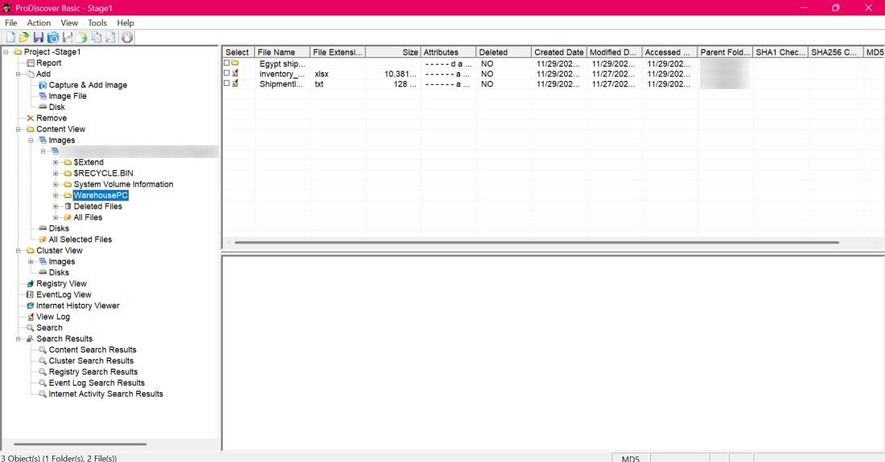
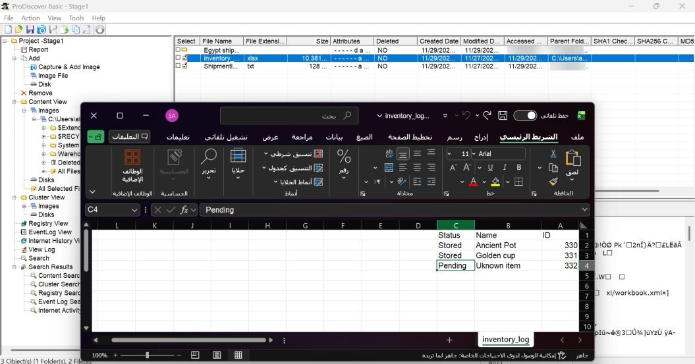
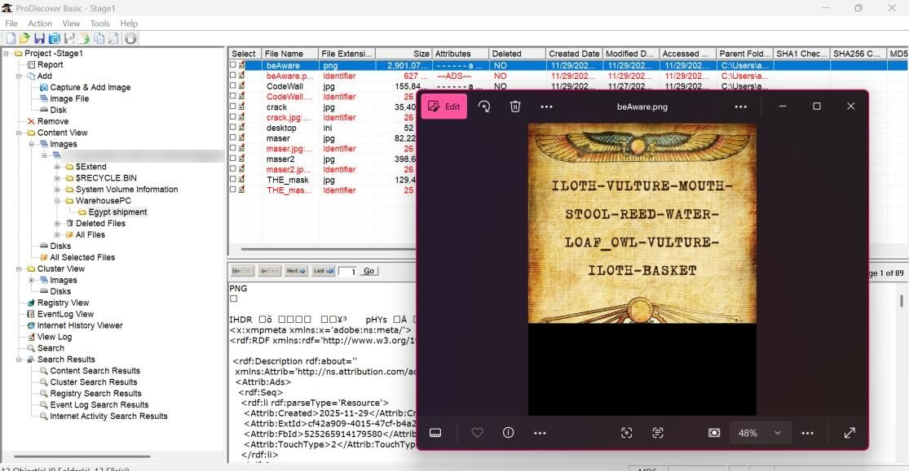
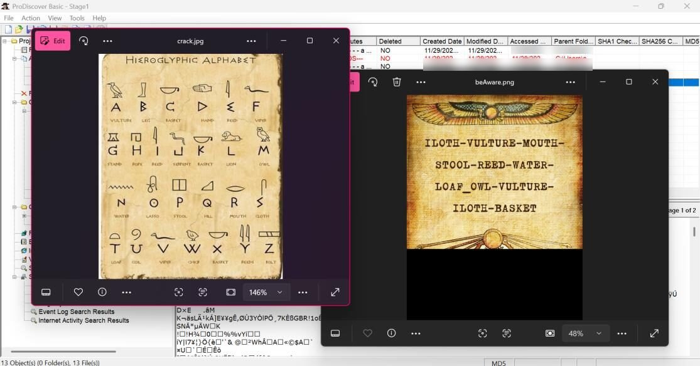
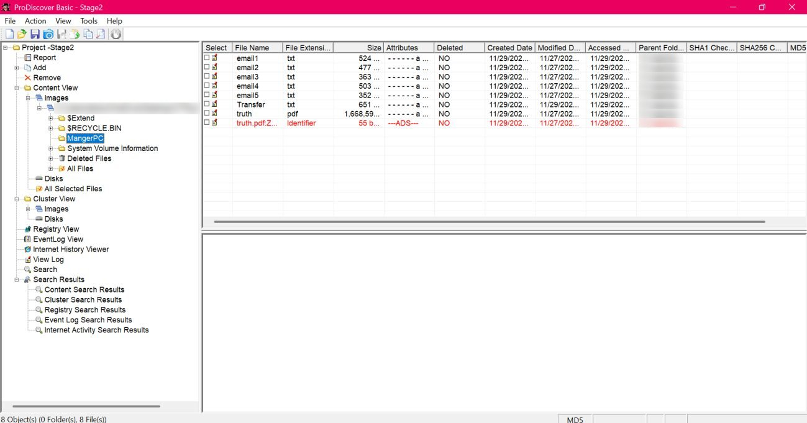
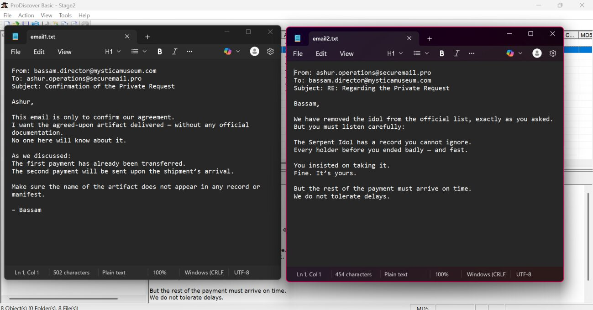
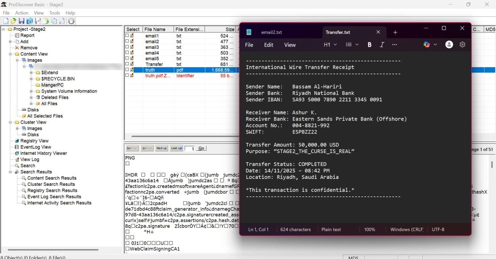

# Challenge 4: The Egyptian Hidden Artifact

**Difficulty:** Medium  
**Solved with:** ProDiscover Basic

## The Case

A museum received an unusual shipment, and one item went missing, which triggered an internal investigation. Two computers were examined: the warehouse PC and the manager's PC. Each one holds evidence, and each stage hides one flag.

**Player task:** Stage 1: find the hidden artifact on the warehouse PC. Stage 2: find out why it went missing.

## Skills Tested

- Working with ProDiscover evidence images
- Solving a substitution cipher (hieroglyphic alphabet)
- Reconstructing events from email evidence across two devices

## How We Built It

- ProDiscover Basic to create the evidence images for both PCs
- A hieroglyph-encoded message and a matching cipher key hidden in separate files
- An email trail between the manager and the thieves

## Solution

<b>Show the full walkthrough (spoilers)</b>

### Step 1: Stage 1: open the warehouse PC

Open Stage1.eve in ProDiscover.

### Step 2: Inspect the warehouse files

Review the files on the warehouse PC.

### Step 3: Spot the missing item

The records show an item from the shipment is missing.

### Step 4: Decode the suspicious image

An image with a suspicious name holds a hieroglyphic message. Another file holds the alphabet to decode it, which reveals the first flag.

### Step 5: Stage 2: open the manager's PC

Inspect the manager's computer.

### Step 6: Read the emails

A series of emails between the manager and the people who stole the idol for him.

### Step 7: Follow the money

The emails keep mentioning a transfer. The transfer record contains the second flag.

**Flag:** `FLAG{SARPENT_MASK} (stage 1), FLAG{STAGE2_THE_CURSE_IS_REAL} (stage 2)`

---

[Previous challenge](../03-integrity-breach) | [All challenges](../../README.md#challenges) | [Next challenge](../05-silent-whisper)
