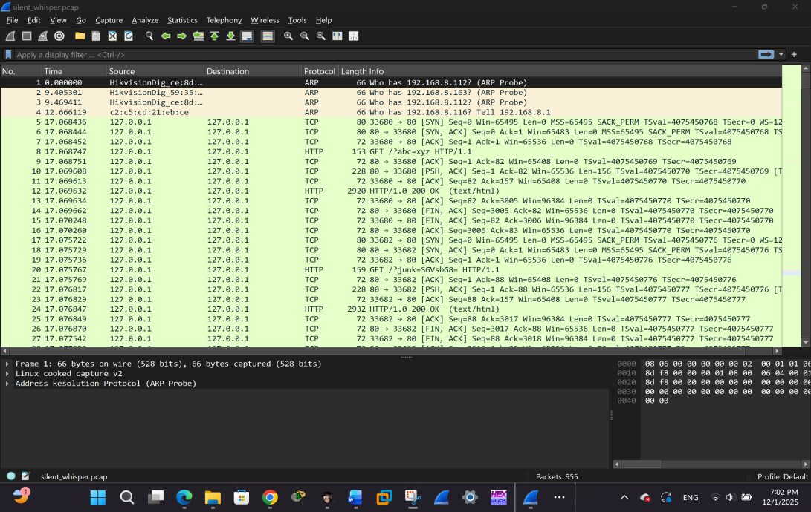
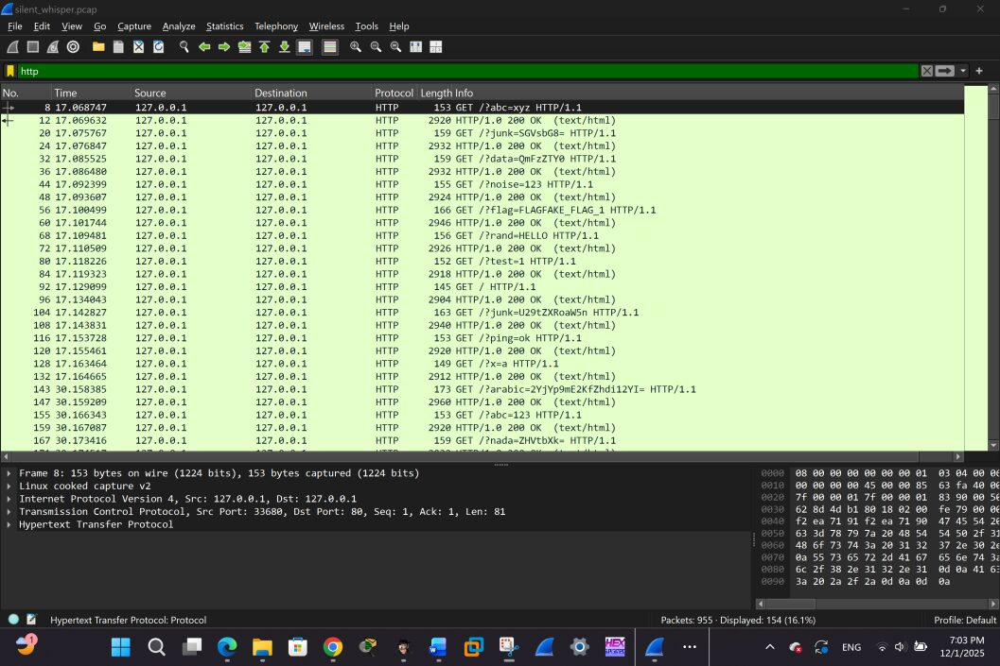
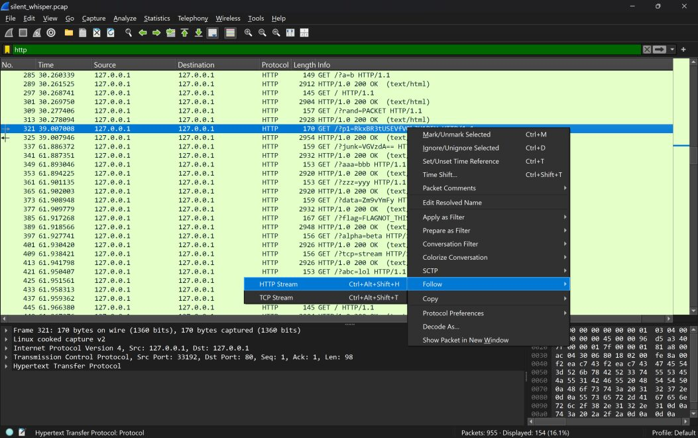
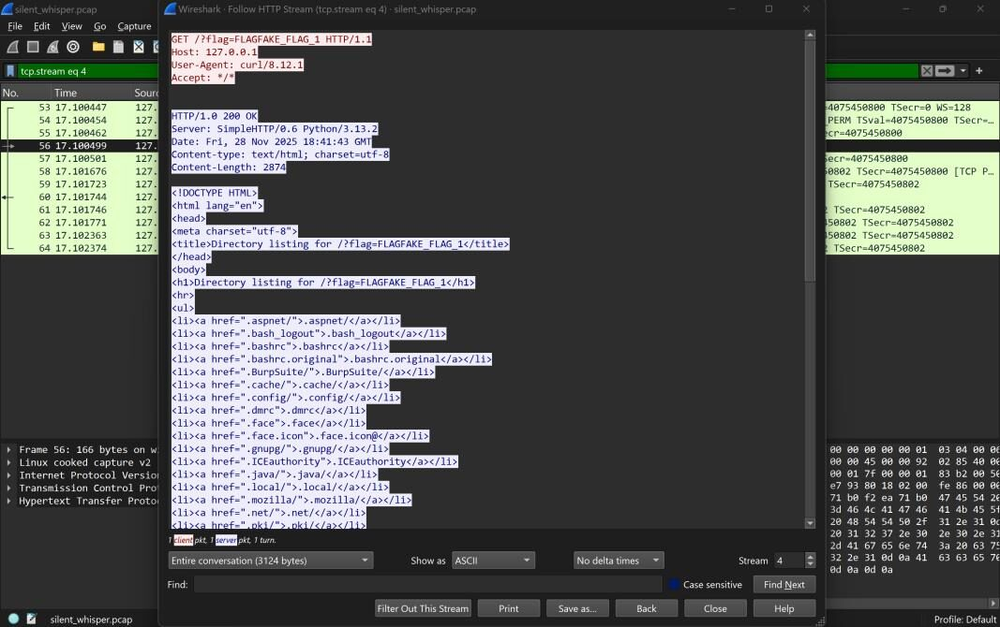
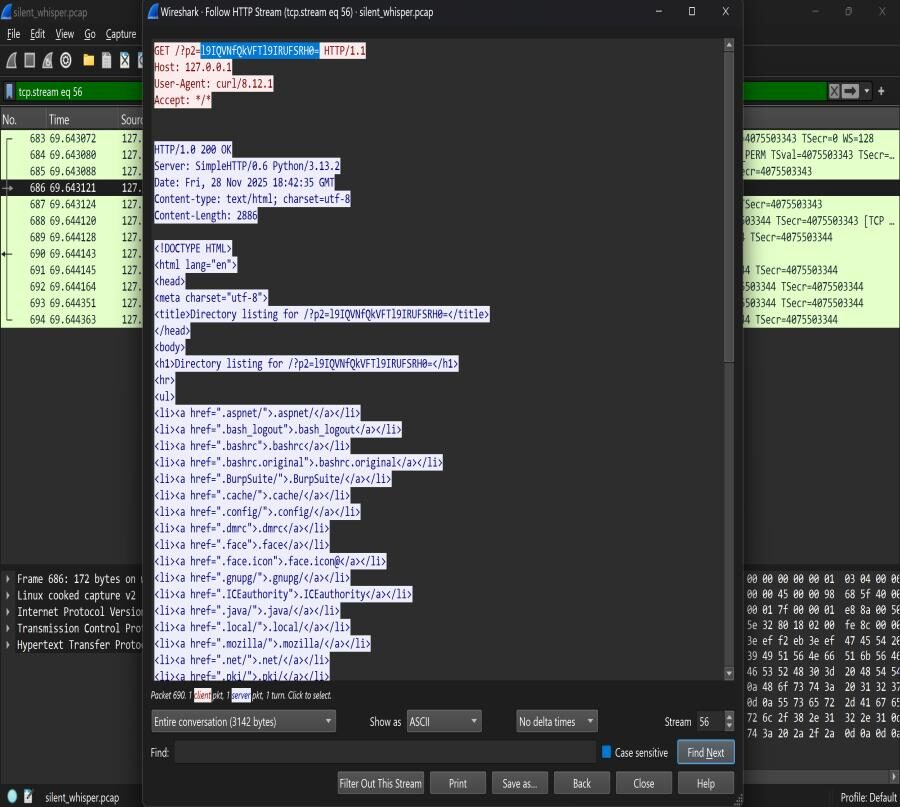
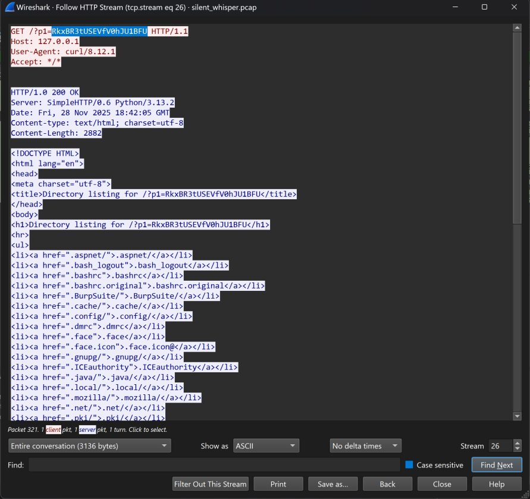
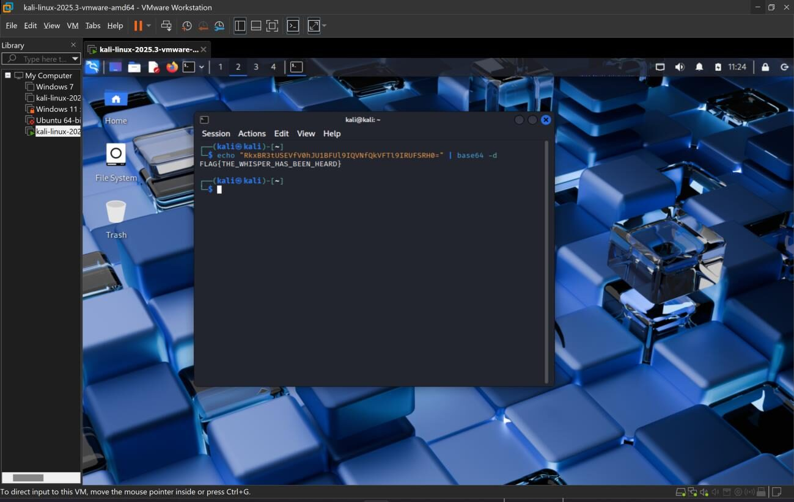

# Challenge 5: Operation Silent Whisper

**Difficulty:** Medium  
**Solved with:** Wireshark, Base64 decoder

## The Case

The Cybercrime Division detected suspicious outbound HTTP traffic from an internal workstation. The attacker tried to exfiltrate information through multiple HTTP GET requests, and a packet capture was collected.

**Player task:** Investigate the traffic, separate the real payload from the decoys, and recover the flag.

## Skills Tested

- Filtering and following HTTP streams in Wireshark
- Recognizing decoy traffic (fake flags, junk Base64, random Unicode)
- Reassembling a payload split across TCP streams and decoding it

## How We Built It

- tcpdump to capture raw traffic
- Python and command-line utilities to generate noise traffic and fake flags
- Kali Linux to encode and split the real payload

## Solution

<b>Show the full walkthrough (spoilers)</b>

### Step 1: Open the PCAP

Load silent_whisper.pcap in Wireshark.

### Step 2: Filter for HTTP

Apply the http filter. Most streams are noise designed to confuse players.

### Step 3: Follow the streams

Use Follow > HTTP Stream on each request and review the parameters.

### Step 4: Rule out the decoys

Most parameters contain fake Base64, fake flags such as FLAG{NOT_THIS_ONE}, and junk values.

### Step 5: Find the real parameters

Two parameters, p1 and p2, carry the actual payload, split across two TCP streams.

### Step 6: Combine the halves

Concatenate p1 and p2 into one Base64 string.

### Step 7: Decode

Base64-decode the combined value to get the flag.

**Flag:** `FLAG{THE_WHISPER_HAS_BEEN_HEARD}`

---

[Previous challenge](../04-egyptian-artifact) | [All challenges](../../README.md#challenges) | [Next challenge](../06-final-post)
