# Challenge 6: The Final Post

**Difficulty:** Hard  
**Solved with:** ProDiscover Basic, CyberChef, Kali Linux (Steghide)

## The Case

Engineer Abdullah suddenly disappeared and left the company. Internal teams suspected he was leaking sensitive information to an outside party. A forensic image of his laptop was acquired shortly afterwards.

**Player task:** Determine whether Abdullah is responsible, how the data was leaked, and what traces he left.

## Skills Tested

- Triage of a laptop disk image
- Analyzing exported social media archives (Twitter and Threads)
- Linking clues across sources to recover a steganography password
- Extracting hidden files with Steghide

## How We Built It

- ProDiscover Basic to create and manage the disk image
- HTML exports of fake Twitter and Threads profiles
- Steghide to hide the leak note inside a photo
- Kali Linux to encode, embed, and test the extraction

## Solution

<b>Show the full walkthrough (spoilers)</b>

### Step 1: Open the disk image

Load Abdullah_Laptop.eve in ProDiscover Basic.

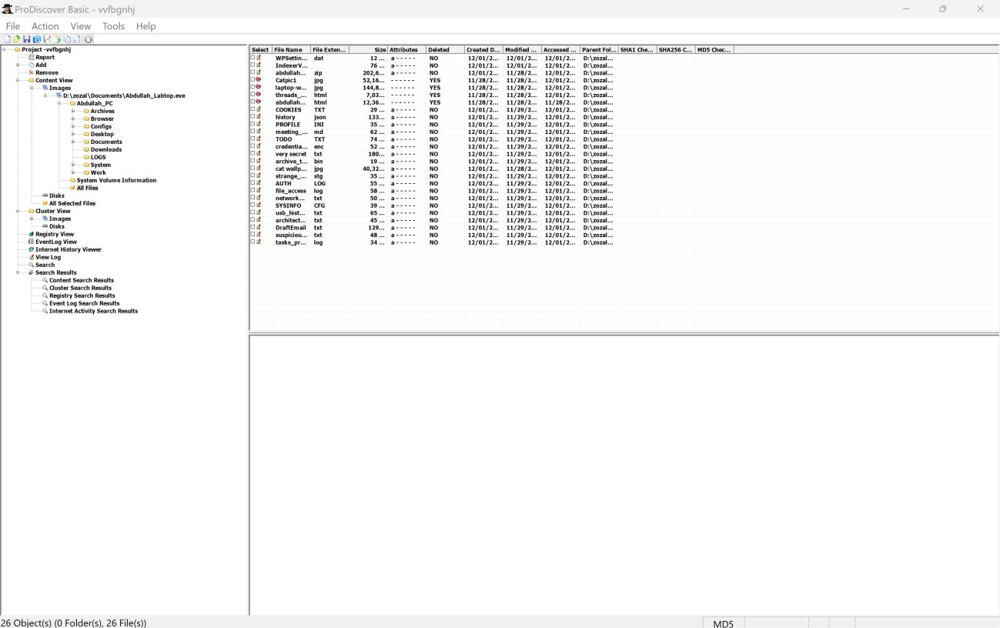

### Step 2: Browse his files

Review the user files on the laptop.

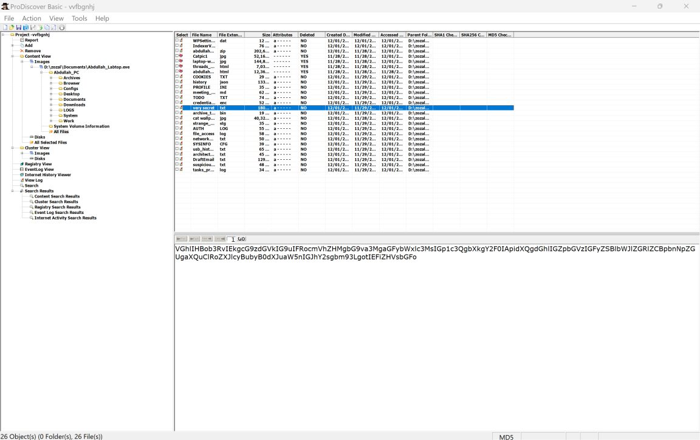

### Step 3: Find the suspicious text file

One file contains a Base64-encoded message that does not look like normal activity.

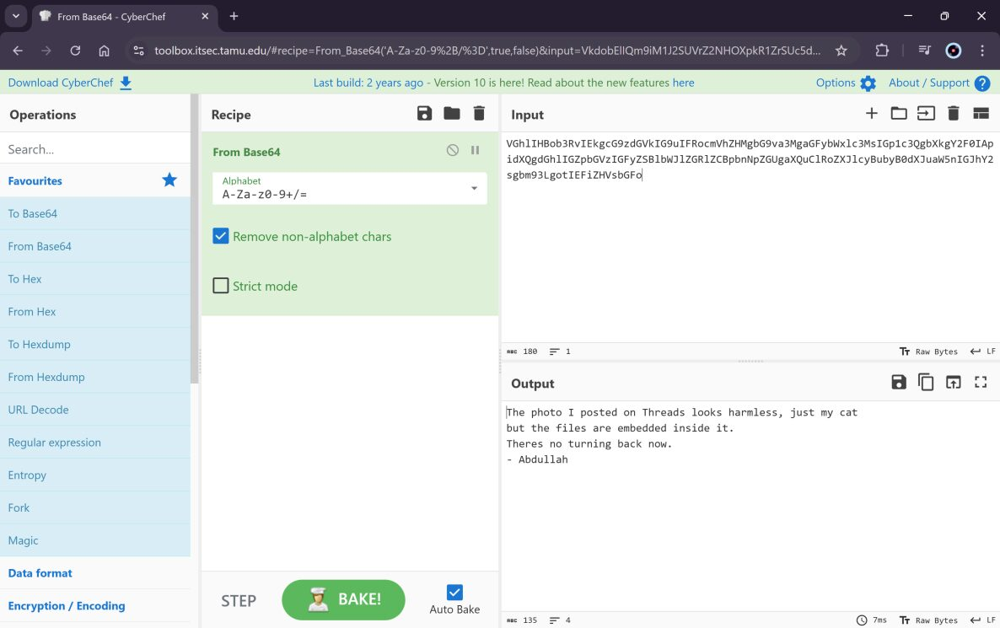

### Step 4: Decode the message

CyberChef's From Base64 reveals a hint pointing to his social media.

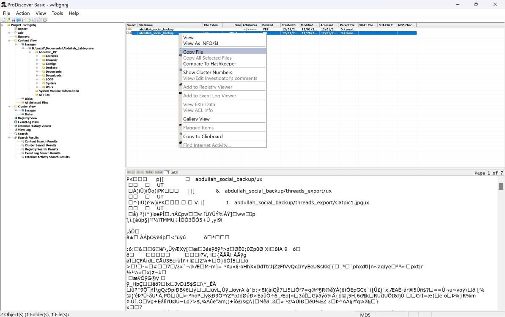

### Step 5: Find the social media backup

The Archives folder holds abdullah_social_backup.zip.

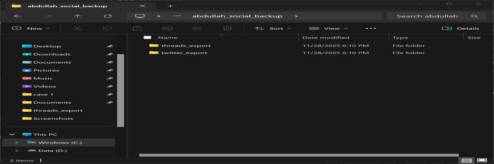

### Step 6: Extract the backup

It contains twitter_export and threads_export folders.

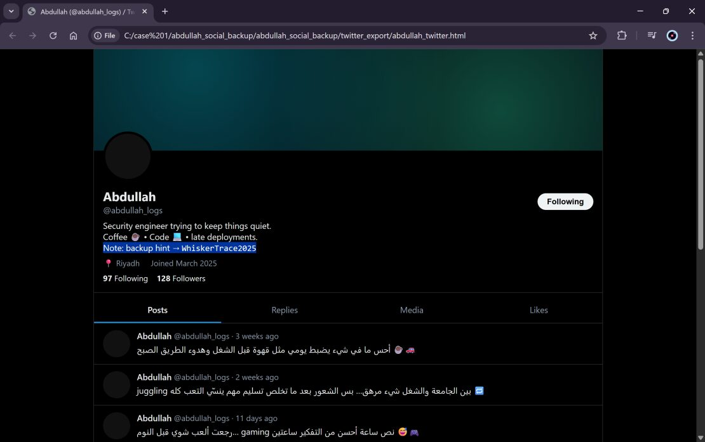

### Step 7: Read the Twitter profile

His bio includes a backup hint: WhiskerTrace2025.

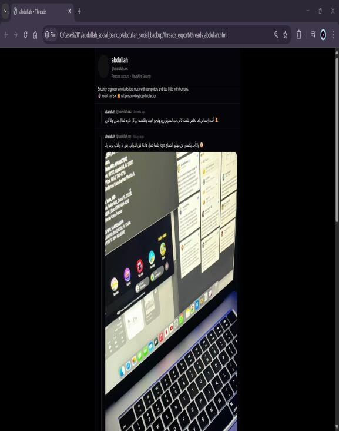

### Step 8: Read the Threads posts

One post stands out: a cat photo whose caption says important things are stored in it.

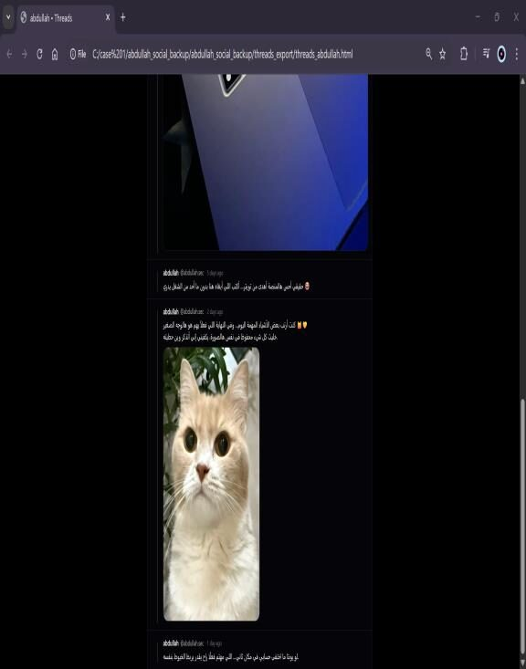

### Step 9: Spot the cat picture

The photo matches the earlier hint about whiskers.

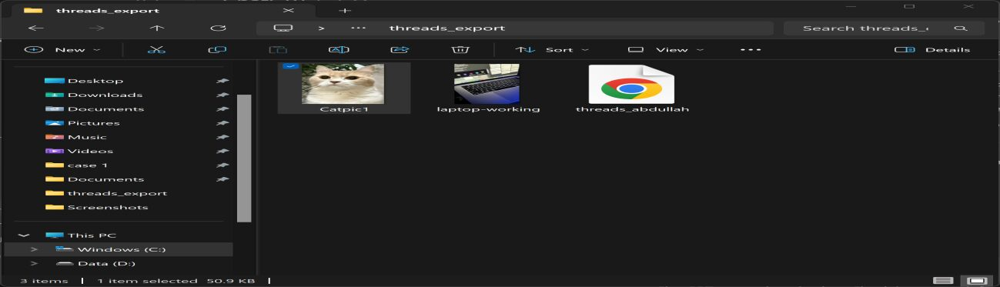

### Step 10: Collect the files

The Threads folder includes Catpic1.jpg.

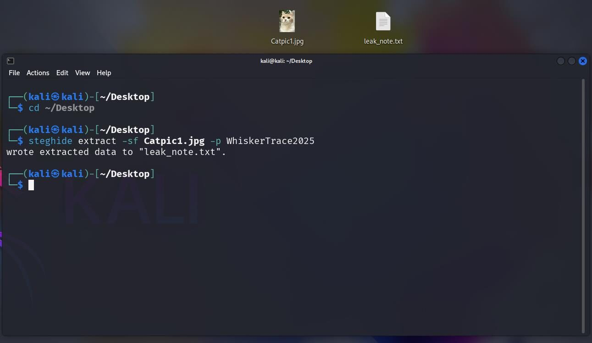

### Step 11: Extract the hidden file

steghide extract -sf Catpic1.jpg with the password from Twitter produces leak_note.txt, confirming the leak.

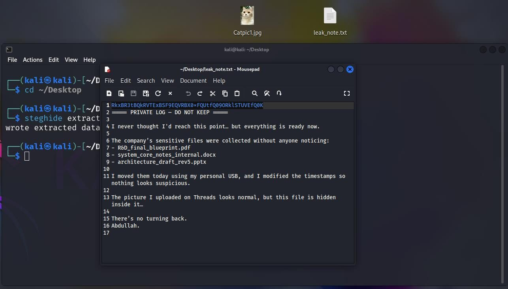

### Step 12: Decode the flag

Base64-decode the content of leak_note.txt.

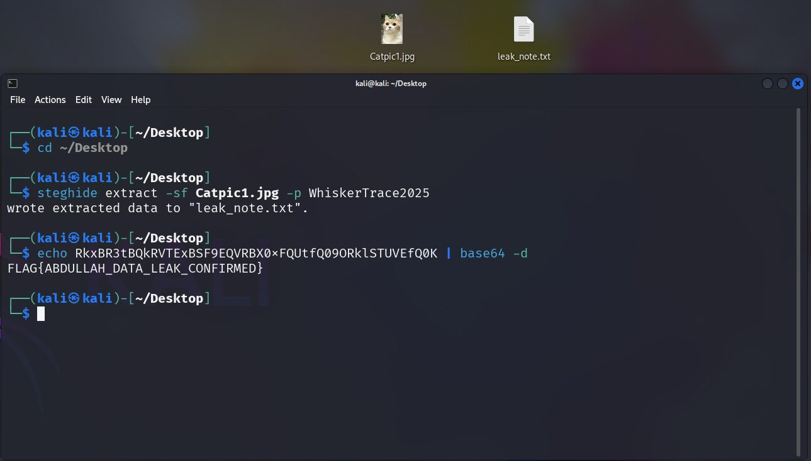

**Flag:** `FLAG{ABDULLAH_DATA_LEAK_CONFIRMED}`

---

[Previous challenge](../05-silent-whisper) | [All challenges](../../README.md#challenges) | [Next challenge](../07-whispered-key)
