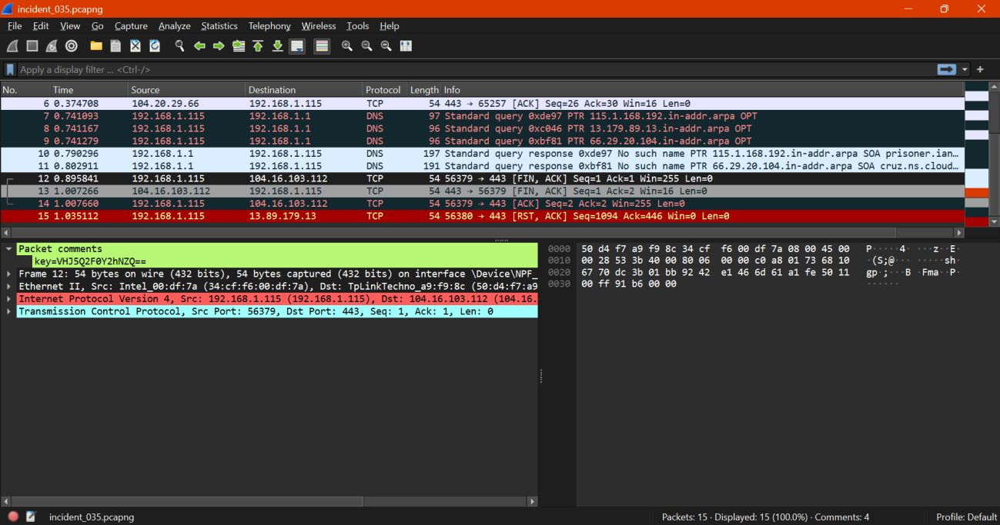
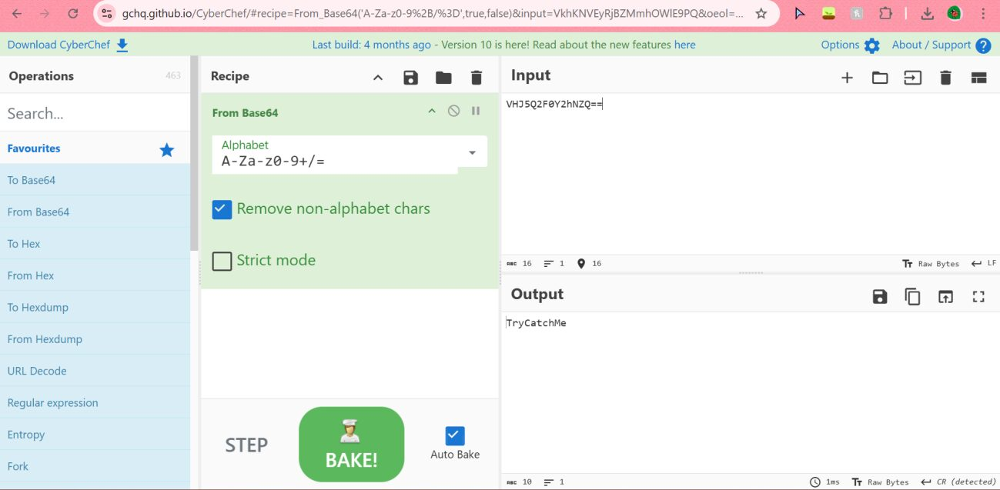
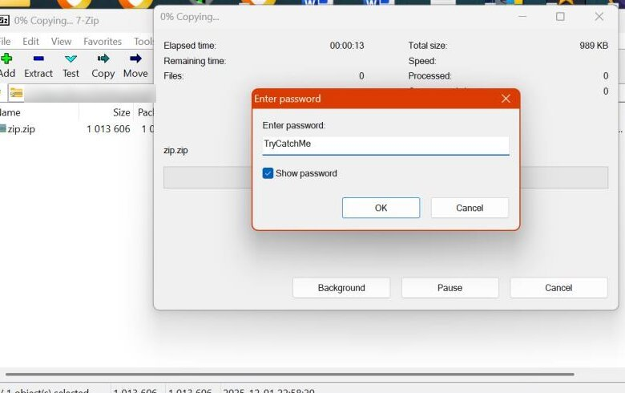
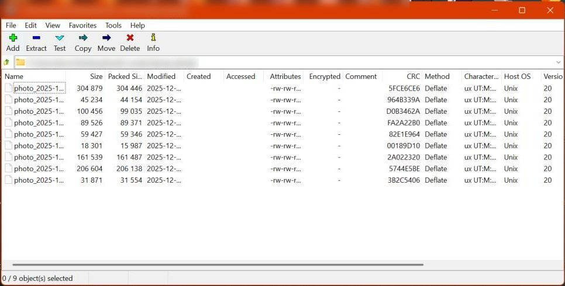
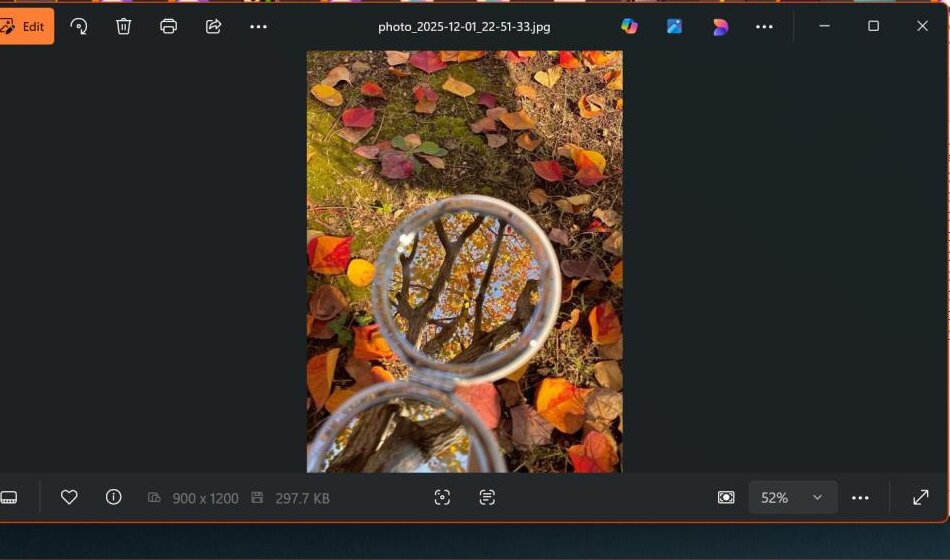

# Challenge 7: The Whispered Key

**Difficulty:** Easy to Medium  
**Solved with:** Wireshark, Base64 decoder, 7-Zip, image viewer

## The Case

The university's security team detected unusual late-night traffic from a student lab computer. Several packets in the capture contained strange embedded comments. Most were fake hints, but one held a real Base64-encoded key. The key unlocks a password-protected ZIP file found on the same machine.

**Player task:** Recover the key from the traffic, open the archive, and find the flag.

## Skills Tested

- Reading packet comments in Wireshark
- Base64 decoding
- Opening AES-256 encrypted archives
- Careful visual inspection of image evidence

## How We Built It

- Wireshark to embed a real key and decoys in packet comments
- 7-Zip with AES-256 to lock the evidence archive
- Images with the flag hidden in very small text

## Solution

<b>Show the full walkthrough (spoilers)</b>

### Step 1: Inspect the capture

Open the network capture in Wireshark.

### Step 2: Find the real key

Check the packet comments and identify the genuine Base64 string among the fake hints.

### Step 3: Decode it

Base64-decode the key to get the ZIP password.

### Step 4: Unlock the ZIP

Open the archive in 7-Zip and enter the decoded password.

### Step 5: Extract the images

The archive holds nine photos that all look ordinary.

### Step 6: Locate the flag

Inspect every image closely. Only one has the flag, in tiny text blended into a corner.

**Flag:** shown in the final screenshot.

---

[Previous challenge](../06-final-post) | [All challenges](../../README.md#challenges) | [Next challenge](../08-hidden-strings)
