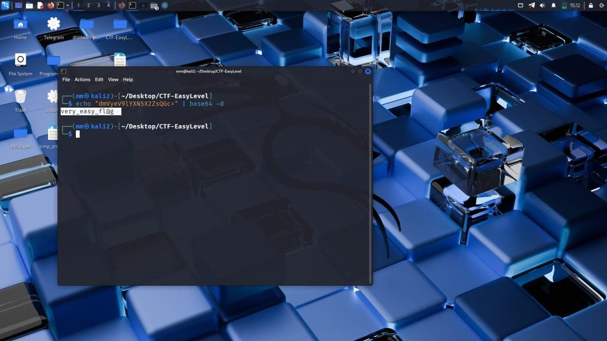
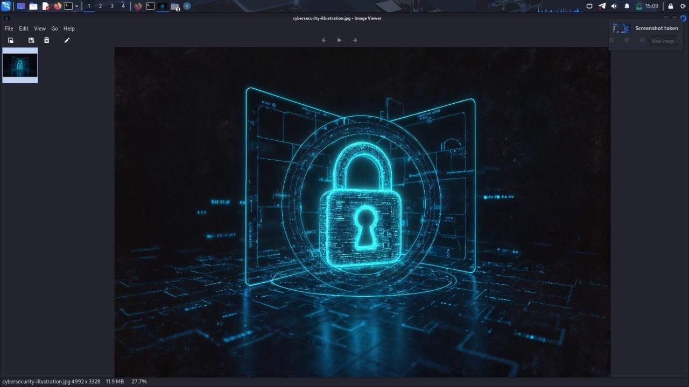
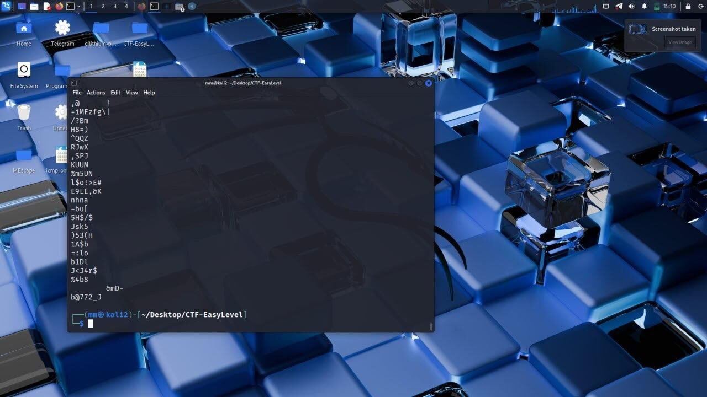
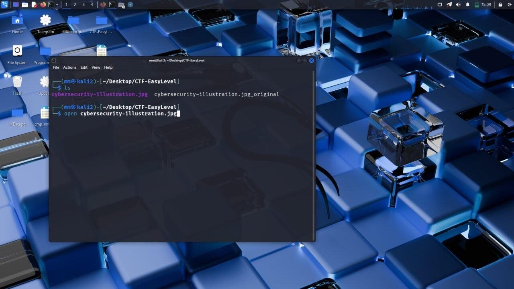
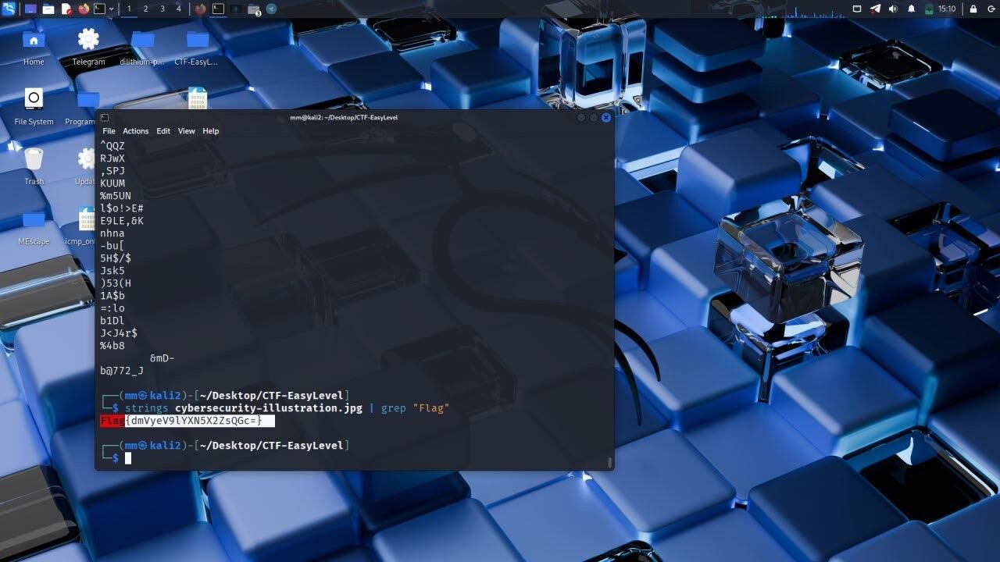
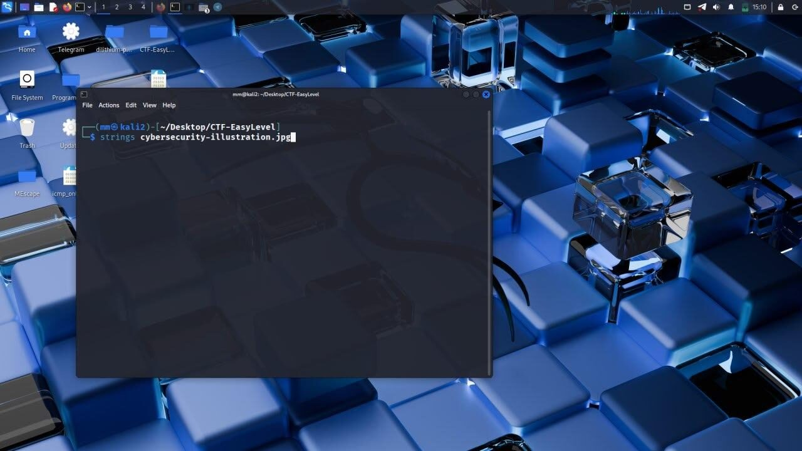

# Challenge 8: Hidden Strings

**Difficulty:** Easy to Medium  
**Solved with:** Kali Linux terminal (strings, grep, base64), image viewer

## The Case

This case continues from [Challenge 7](../07-whispered-key). After unlocking the encrypted ZIP file with the password from the packet capture, investigators found several images that looked normal. One of them contains hidden data embedded in the file itself.

**Player task:** Find and decode the data hidden inside the image.

## Skills Tested

- Extracting readable strings from binary files
- Filtering output with grep
- Decoding Base64 from the terminal

## How We Built It

- Kali Linux to embed a Base64 value in the image data
- Testing that the image still looks unchanged when opened

## Solution

<b>Show the full walkthrough (spoilers)</b>

### Step 1: Recover the password

Decode the Base64 key from the packet capture with base64 -d.

### Step 2: Open the image

Unlock the archive and open the image. It looks completely normal.

### Step 3: Run strings

Run strings on the JPEG to dump readable text from the binary.

### Step 4: Search for the indicator

Pipe the output to grep "Flag" to find the embedded value.

### Step 5: Review the full output

A complete strings dump confirms there is no other hidden text.

### Step 6: Decode the flag

Base64-decode the value found by grep to reveal the flag.

**Flag:** shown in the final screenshot.

---

[Previous challenge](../07-whispered-key) | [All challenges](../../README.md#challenges)
